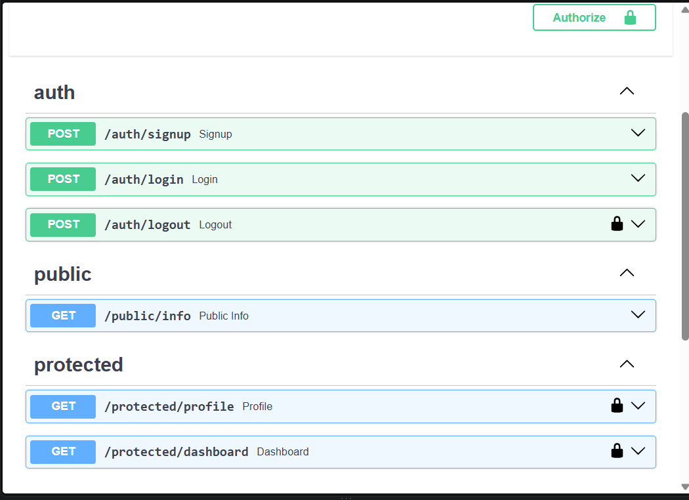
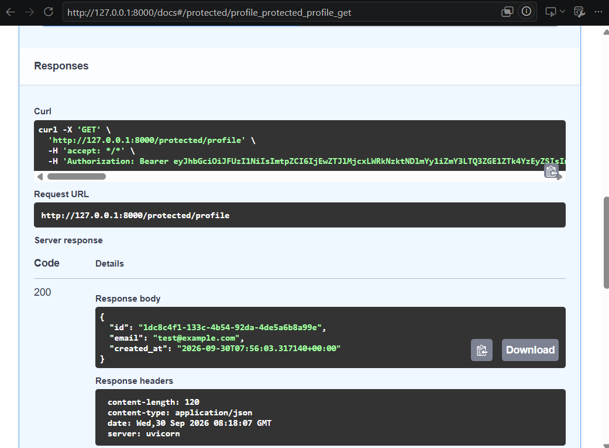

# Auth API: Login & Protect

A FastAPI backend that handles user authentication with **Supabase Auth**: sign up, log in, and log out. It also protects routes so they answer only for logged-in users.

The server never stores or hashes passwords itself. Supabase stores the accounts, hashes the passwords, and signs the JSON Web Tokens (JWTs). This API forwards credentials to Supabase and **verifies the token** on every protected request before it lets the request through.

FlyRank Internship · Backend Track · Week 2 · Assignment A4

## How it works

```
1. Client  ──email + password──▶  POST /auth/login  ──▶  Supabase Auth
2. Client  ◀──────── access_token (JWT) ─────────────────  Supabase Auth
3. Client  ──Authorization: Bearer <token>──▶  GET /protected/profile
4. API     ──"is this token real?"──▶  Supabase  ──yes──▶  200 + user data
                                                  ──no───▶  401
```

All protected routes share one guard, the `get_current_user` dependency in [auth_guard.py](auth_guard.py). The guard does three things:

1. It reads the `Authorization: Bearer <token>` header. If the header is missing or malformed, it returns `401`.
2. It asks Supabase to verify the token with `auth.get_user(token)`. If the token is forged, expired, or logged out, it returns `401`.
3. It passes the verified user to the route.

To protect a new route, add `user: User = Depends(get_current_user)` to its parameters. No other auth code is needed.

## Tech stack

- Python 3.10+ with FastAPI and Uvicorn
- Supabase Auth through the `supabase` Python SDK
- `python-dotenv` for configuration
- Swagger UI (built into FastAPI) with bearer auth

## Setup

### 1. Create a Supabase project

1. Create a free project at [supabase.com](https://supabase.com). No credit card is needed.
2. Find the **Project URL** under **Settings → Data API**. You can also click **Connect** in the top bar.
3. Find the **anon / public** key under **Settings → API Keys → Legacy anon, service_role API keys**.
   Never use the `service_role` key: it bypasses all security.
4. Under **Authentication → Sign In / Providers → Email**, turn **Confirm email** off. New users can then log in right after they sign up. Leave it on in production.

### 2. Clone and install

```bash
git clone <this-repo-url>
cd Auth_Login_Protect
python -m venv .venv
```

Activate the virtual environment:

- Windows: `.venv\Scripts\activate`
- macOS/Linux: `source .venv/bin/activate`

Install the dependencies:

```bash
pip install -r requirements.txt
```

### 3. Configure environment variables

Copy the example file:

- Windows: `copy .env.example .env`
- macOS/Linux: `cp .env.example .env`

Fill in your own values in `.env`:

```
SUPABASE_URL=https://your-project-id.supabase.co
SUPABASE_KEY=your-anon-key
PORT=8000
```

`.env` is git-ignored and is never committed. Use the Project URL without `/rest/v1/` at the end.

## Run

```bash
python main.py
```

On startup, the server checks that it can reach Supabase with your key. It then logs:

```
Server running and connected to Supabase
```

If `SUPABASE_URL` or `SUPABASE_KEY` is missing or wrong, the server stops with an error.

- API: http://127.0.0.1:8000
- Swagger UI: http://127.0.0.1:8000/docs

## API reference

| Method | Route | Purpose | Auth header | Success |
|---|---|---|---|---|
| `POST` | `/auth/signup` | Create a new user account | none | `201` user object |
| `POST` | `/auth/login` | Log in and get a JWT | none | `200` `access_token`, `refresh_token` |
| `POST` | `/auth/logout` | End the current session | `Authorization: Bearer <token>` | `204` no content |
| `GET` | `/protected/profile` | Read your profile (`id`, `email`, `created_at`) | `Authorization: Bearer <token>` | `200` |
| `GET` | `/protected/dashboard` | Second protected route, uses the same guard | `Authorization: Bearer <token>` | `200` |
| `GET` | `/public/info` | Read public information | none | `200` |

### Errors

Every error is JSON in the form `{"error": "<message>"}`.

| Status | When |
|---|---|
| `400` | `email` or `password` is missing, the body is not a JSON object, or Supabase rejects the signup (for example, a user that is already registered) |
| `401` | Login with a wrong email or password: `Invalid login credentials` |
| `401` | No `Authorization` header, or it is not `Bearer <token>`: `Access token required` |
| `401` | The token is forged, tampered with, expired, or logged out: `Invalid or expired token` |
| `429` | Supabase rate-limited the signup or login request |

## Try it with curl

The examples use a `bash` shell (macOS, Linux, or Git Bash on Windows).

```bash
# Sign up. Returns 201.
curl -i -X POST http://127.0.0.1:8000/auth/signup \
  -H "Content-Type: application/json" \
  -d '{"email":"test@example.com","password":"password123"}'

# Log in. Returns 200 and an access_token.
curl -i -X POST http://127.0.0.1:8000/auth/login \
  -H "Content-Type: application/json" \
  -d '{"email":"test@example.com","password":"password123"}'

# Public route. Returns 200.
curl -i http://127.0.0.1:8000/public/info

# Protected route without a token. Returns 401.
curl -i http://127.0.0.1:8000/protected/profile

# Protected route with the token from login. Returns 200.
curl -i http://127.0.0.1:8000/protected/profile \
  -H "Authorization: Bearer <PASTE_YOUR_ACCESS_TOKEN_HERE>"

# Change one character of the token and run the previous command again. Returns 401.

# Log out. Returns 204. After this, the same token returns 401.
curl -i -X POST http://127.0.0.1:8000/auth/logout \
  -H "Authorization: Bearer <PASTE_YOUR_ACCESS_TOKEN_HERE>"
```

## Swagger UI

Open http://127.0.0.1:8000/docs. A padlock marks each protected route: `/auth/logout`, `/protected/profile`, and `/protected/dashboard`.



1. Run **POST /auth/login** with **Try it out**. Copy the `access_token` from the response body.
2. Click **Authorize** at the top right. Paste the token without the word `Bearer`, then click **Authorize**.
3. Run **GET /protected/profile** with **Try it out**. The response is `200` with your user details.



## Project structure

| File | Purpose |
|---|---|
| [main.py](main.py) | App setup, Supabase startup check, JSON error handlers, run command |
| [supabase_client.py](supabase_client.py) | Loads `.env` and creates Supabase clients |
| [auth_guard.py](auth_guard.py) | Reusable guard: bearer token extraction and Supabase verification |
| [auth_routes.py](auth_routes.py) | `/auth/signup`, `/auth/login`, `/auth/logout` |
| [protected_routes.py](protected_routes.py) | `/protected/profile`, `/protected/dashboard` |
| [public_routes.py](public_routes.py) | `/public/info` |
| [.env.example](.env.example) | The required environment variables, with placeholder values |

## Design notes

- **One client per request.** A Supabase client remembers the session of whoever last logged in with it. If one global client served every user, their sessions would mix. For this reason, each request creates its own client, with session storage and background token refresh turned off.
- **Logout revokes the session.** The per-request client has no stored session, so a plain `auth.sign_out()` would have nothing to revoke. Instead, logout calls `auth.admin.sign_out(token)`, which is the call `sign_out()` makes internally. It sends the user's own JWT, not the `service_role` key, and ends that session on Supabase. Because `get_user` checks that the session still exists, the old token then returns `401`.
- **Antivirus HTTPS scanning.** Some antivirus products (for example, AVG) re-sign HTTPS certificates. Python's bundled certificates then fail with `CERTIFICATE_VERIFY_FAILED`. [supabase_client.py](supabase_client.py) uses `truststore`, which makes Python trust the operating system's certificate store. On other machines, this has no effect.
